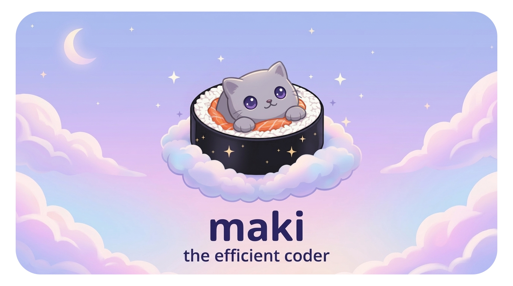
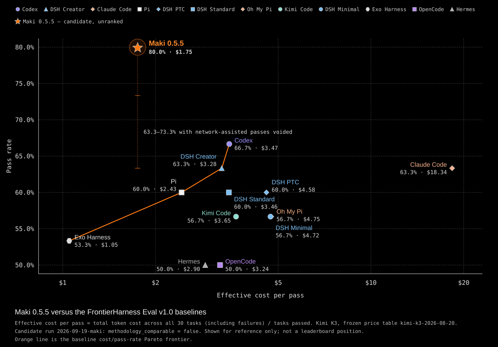

An AI coding agent optimized for minimal use of context tokens, while providing a great user experience.

I got frustrated with existing coding agents and hitting hourly/weekly token limits, so I built maki. It's a single Rust binary with a TUI, a bunch of tricks to keep junk out of the context window, and a Neovim style Lua plugin system.

```sh
curl -fsSL https://maki.sh/install.sh | sh
```

Other platforms and ways to install are [below](#installation). [Docs](https://maki.sh/docs) · [Plugins](https://maki.sh/plugins/) · [Discord](https://discord.gg/8VKuA4naC3)

## Benchmarks



[FrontierHarness Eval](https://frontierharness.org/) benchmark result, [click here to download report.zip](https://github.com/tontinton/maki/releases/download/v0.5.5/frontierharness-report-2026-09-21.zip)

## Features

### Context efficiency

The whole conversation is re-sent to the model on every turn, so anything that lands in context is paid for again and again until the session ends. Most of maki is about keeping stuff out of there. The long version is in [Token Economy](https://maki.sh/docs/token-economy/).

* `index` tool - uses [tree-sitter](https://tree-sitter.github.io/tree-sitter) to parse supported programming languages to produce a high level skeleton of a file, with exact start-end lines of each item (e.g. a function's implementation is in lines 150-165). Encouraged to be used before reads. For my usage it adds 59 tok/turn but saves 224 tok/turn on read calls, saving 165 tok/turn.
* `code_execution` tool - uses [monty](https://github.com/pydantic/monty) to run an interpreter that has all other tools available as async functions. Maki uses it to filter / summarize / transform / pipe data to other tools as input, without it ever reaching and polluting the context window. MCP tools are callable from it too, and `open()` reads files through maki. Sandbox limited by time & memory.
* `task` tool - when delegating work to subagents, the AI chooses whether to run weak / medium / strong model of used provider. Think haiku / sonnet / opus. The subagent burns its own context on greps and dead ends, only the summary comes back to yours.
* MCP tools are deferred behind a single `tool_search` tool. Datadog's MCP server alone has over 100 tools, and you don't want all of those definitions in every request when the model uses maybe two.
* Background tasks - press Ctrl-B on a slow build, test run or subagent, and the model gets a short receipt and keeps working. The result arrives as a message when it's done, so no turns are wasted on polling. The model can also start things in the background on its own.
* Interrupting isn't a waste. Press Escape on a long running tool and whatever it printed so far still goes to the model, marked as partial, so the next turn doesn't run it all again.
* Long bash output keeps both the start and the end, since the errors and the test summary are usually at the end.
* System prompt, tool descriptions, and tool examples are all concise, I've made sure not to bloat your context.
* Uses [rtk](https://github.com/rtk-ai/rtk) if you have it installed, disable with `maki.setup({ agent = { rtk = false } })` in your `init.lua`. Saves ~50% of bash output tokens. Remember bash is just 12% of total token usage, so 6% is nice, but saving on reads (65% of total) by using `index` gave me more benefit. I think I'll do bash output filtering like this myself in a future release.

### User experience

* SUPER fast startup, 60 FPS, and light on memory. Not running any JavaScript, using [ratatui](https://ratatui.rs) for TUI. Even the splash screen animation uses SIMD.
* Philosophy of not hiding anything - while other coding agents hide information as models improve (e.g. not showing number of lines read), maki leaves you in control. Tokens, cost and model are always in the status bar, and `/usage` breaks it down per model.
* UI fits everything well on my small screen laptop.
* Full visibility of subagents - each subagent gets their own "chat window" you can easily navigate between using `/tasks` (Ctrl-X). You can type into a running subagent's window to queue a message for it, or stop it with Ctrl-S.
* Rewind on Escape-Escape (no code rewind yet, only chat history). Ctrl-F in the rewind picker forks the session at that prompt instead, and `/fork` copies the whole session.
* Resume sessions with `-c` / `-r <id>`, or browse them with Ctrl-P. `maki session export` / `import` moves one to another machine.
* A `memory` tool to keep long term context, just tell maki to remember something (sometimes it uses it automatically). Managed via `/memory` (view / edit / delete memories).
* Plan mode. Ctrl-T shows the plan, Ctrl-O opens it in your editor.
* `/btw` to run a command with the chat history without interfering with the current session.
* Run bash commands using `!`, or `!!` if you want maki to not know about it.
* Fuzzy search with Ctrl-F.
* Attach images in prompts, rendered inline in terminals that support it.
* 33 themes, plus a `system` one that uses your terminal's own colors. Give it a light and a dark theme and it picks by your terminal's background.
* Notifications when a turn ends or maki needs your answer (OSC 9, terminal bell, or a desktop notification).
* Skills & MCPs (stdio or HTTP, with OAuth).
* `/cd` to change dir.
* `maki update` to get the latest release, `maki rollback` if it broke something.

### Safety

* Sensible permission system - when the agent runs `git diff && rm -rf /`, what do you think will happen in your current coding agent? It will treat it as `git *`. Maki uses tree-sitter to parse the bash command and figure out the permissions requested are `git *` and `rm *`. Disable using `--yolo`.
* Folder trust - a repo you just cloned can ship a `.maki/` dir with an `init.lua`, MCP servers and a `.env`. None of it loads until you trust the folder. Its permission `deny` rules apply anyway, so a repo can only make the agent more restricted. See [Folder Trust](https://maki.sh/docs/folder-trust/).
* SSRF protection on `webfetch` calls.

### Lua plugins

* Extend with neovim like Lua plugins - [Builtin plugins](https://github.com/tontinton/maki/tree/main/plugins), [Community plugins](https://maki.sh/plugins/), [User made plugins showcase](https://github.com/tontinton/maki/discussions/452), [Lua API reference](https://maki.sh/docs/lua-api/).
* Every builtin tool (`read`, `bash`, `edit`, even `batch`) is itself a Lua plugin, so anything maki does out of the box your plugin can do too. Tools, slash commands, keymaps, UI, providers.
* Install packages from git with `maki.pack.add`. They get locked to a commit in `pack-lock.json`, so you can commit it with your dotfiles. See [Lua Packages](https://maki.sh/docs/packages/).
* [Hooks](https://maki.sh/docs/hooks/) to rewrite a tool call before it runs, or filter its output before the model sees it (e.g. redacting secrets).

### Outside the TUI

* Use `--print --output-format stream-json` to run UI-less. Output is compatible with Claude Code, so you can easily replace your existing solutions. Same goes for `--input-format stream-json`, which speaks the Claude Code SDK protocol. See [Headless Mode](https://maki.sh/docs/headless/).
* ACP, for editors like Zed. See [below](#acp).
* Opt-in [OpenTelemetry](https://maki.sh/docs/telemetry/) export, same format as Claude Code's.

## Supported providers

| Provider | How to auth |
|---|---|
| Anthropic | `ANTHROPIC_API_KEY` only (using OAuth is against TOS). Bedrock supported via `CLAUDE_CODE_USE_BEDROCK=1`. |
| OpenAI | `OPENAI_API_KEY`, or OAuth via `maki auth login openai` |
| xAI | `XAI_API_KEY`, or OAuth via `maki auth login xai` |
| Google | `GEMINI_API_KEY` |
| Copilot | `GH_COPILOT_TOKEN`, an existing GitHub Copilot sign-in at `~/.config/github-copilot/`, or `maki auth login copilot` to import one |
| Ollama | `OLLAMA_HOST` for local (e.g. `http://localhost:11434`), or `OLLAMA_API_KEY` for cloud |
| llama.cpp | `LLAMA_CPP_HOST` (e.g. `http://localhost:8080`), optionally `LLAMA_CPP_API_KEY` |
| Mistral | `MISTRAL_API_KEY` |
| Z.AI | `ZHIPU_API_KEY` |
| DeepSeek | `DEEPSEEK_API_KEY` |
| OpenRouter | `OPENROUTER_API_KEY` |
| Requesty | `REQUESTY_API_KEY`. Set `REQUESTY_BASE_URL=https://router.eu.requesty.ai/v1` for the EU region. |
| Synthetic | `SYNTHETIC_API_KEY` |
| Regolo | `REGOLO_API_KEY`. EU-hosted open-weight models. |
| TensorX | `TENSORX_API_KEY` |
| OpenCode Zen | `OPENCODE_API_KEY`, or the free `public` key for zero-cost models. Models from the models.dev catalog. |
| OpenCode Go | `OPENCODE_API_KEY`. Models from the models.dev catalog. |
| Aperture | `APERTURE_HOST` (e.g. `https://your-host.tailnet.ts.net`). No API key needed, Tailscale handles auth. |

Anything else that speaks the OpenAI or Anthropic API can be added as a custom provider in config.

**Plugin providers** - a Lua plugin can register a provider with `maki.provider.register`, and its models behave like any built-in provider's. Handy for a company gateway behind SSO. See [docs](https://maki.sh/docs/providers/#plugin-providers) for details.

## Installation

```sh
# Linux / macOS / Git Bash on Windows
curl -fsSL https://maki.sh/install.sh | sh

# Windows (PowerShell)
irm https://maki.sh/install.ps1 | iex

# Homebrew
brew install maki

# Nix
nix run github:tontinton/maki

# Living on the edge (main branch)
cargo install --locked --git https://github.com/tontinton/maki.git maki
```

Don't blindly trust shell scripts, download it first (`curl -fsSL https://maki.sh/install.sh -o install.sh`, or `irm https://maki.sh/install.ps1 -OutFile install.ps1`), read it, then run it.

The scripts install to `~/.local/bin`, or `%LOCALAPPDATA%\maki` on Windows (added to your user PATH). Override with `MAKI_INSTALL_DIR` / `$env:MAKI_INSTALL_DIR`.

Or download a pre-built binary from [GitHub Releases](https://github.com/tontinton/maki/releases/latest).

Then set an API key for one of the [providers](#supported-providers) and run `maki` in your project. Config lives in `~/.config/maki/init.lua`, the [Quick Start](https://maki.sh/docs/quick-start/) goes through the rest.

## ACP

Run `maki acp` or configure your ACP supporting editor to use maki, e.g. in [Zed](https://zed.dev/)'s `settings.json`:

```json
"agent_servers": {
  "Maki": {
    "default_config_options": {
      "model": "deepseek/deepseek-flash"
    },
    "type": "custom",
    "command": "maki",
    "args": ["acp"],
    "env": {}
  }
}
```

## Example config

[tontinton/makiconf](https://github.com/tontinton/makiconf) - includes a [semble](https://github.com/MinishLab/semble) tool (Lua code) for semantic code search, and an [ast-grep](https://ast-grep.github.io) MCP server for AST-based search and replace.

## Community

[](https://discord.gg/8VKuA4naC3)
